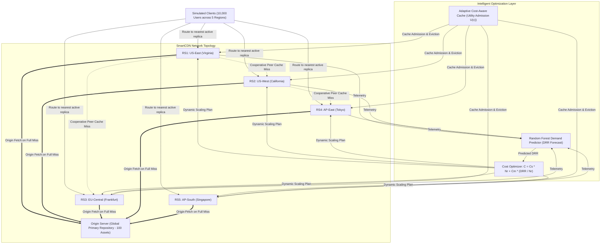

# SmartCDN – Machine Learning-Based Adaptive Replica Server and Cache Optimization System

[](https://www.python.org/)
[](https://flask.palletsprojects.com/)
[](https://react.dev/)
[](https://tailwindcss.com/)
[](https://scikit-learn.org/)
[](https://ieee.org/)

**SmartCDN** is an enterprise-grade Cloud Content Delivery Network (CCDN) management, simulation, and cost-optimization platform. Inspired by the IEEE research paper:

> **"Cost-balanced Adaptive Replica Server Cache Management under Time-Varying User Request Density in CCDNs" (2025)**

SmartCDN addresses the critical trade-off between **active replica server storage/running costs** ($C_s$) and **cache miss penalty costs** ($C_m$) under continuously fluctuating, multi-region user request density. It extends the research paper with a **Machine Learning-based Demand Predictor (Random Forest Regressor)** and provides an interactive operational platform for cloud infrastructure architects.

---

## 📑 Table of Contents
1. [Core Features](#-core-features)
2. [System Architecture](#-system-architecture)
3. [Algorithmic Foundations](#-algorithmic-foundations)
4. [Machine Learning Demand Predictor](#-machine-learning-demand-predictor)
5. [Synthetic Dataset Generation](#-synthetic-dataset-generation)
6. [Technology Stack](#-technology-stack)
7. [Project Folder Structure](#-project-folder-structure)
8. [Installation & Quick Start (Windows / VS Code)](#-installation--quick-start-windows--vs-code)
9. [REST API Documentation](#-rest-api-documentation)
10. [Testing Instructions](#-testing-instructions)
11. [GitHub Deployment Instructions](#-github-deployment-instructions)

---

## 🚀 Core Features

### 1. Operational Real-Time Dashboard
- **10 Core KPI Cards**: Active Replica Count, Total Requests Served, Cache Hit Ratio, Miss Ratio, Avg Latency (ms), Total Storage Cost ($), Total Miss Penalty Cost ($), Operating Cost ($), Server Utilization (%), and Estimated Cost Savings ($).
- **5 Live Recharts Visualizations**:
  - Request Density Over Time (DRR) for RS1–RS5
  - Replica Server Utilization (% CPU / Memory)
  - Cache Performance (Local Hits vs Peer Hits vs Origin Misses)
  - Cost Accumulation Trends (Storage vs Miss Penalties)
  - Real-Time Request Stream Ticker with routing telemetry

### 2. Interactive Live Simulation Module
- Multi-tier CDN Topology: 1 Central Origin Server $\rightarrow$ 5 Regional Replica Servers (RS1–RS5) $\rightarrow$ 10,000 Simulated Users.
- Controls: Start, Pause, Step Batch, Reset, Speed Acceleration (1x, 2x, 5x, 10x), and Traffic Intensity Multipliers (0.2x – 5.0x).
- 3-Tier Request Routing:
  1. **Local Replica Cache**: Ultra-low latency (~16ms), zero miss penalty.
  2. **Peer Cooperative Replica Cache**: Low latency (~55ms), inter-datacenter transit.
  3. **Central Origin Repository**: High latency (~165ms), full miss penalty.

### 3. Server Fleet Management
- Live resource monitoring for RS1 (US-East), RS2 (US-West), RS3 (EU-Central), RS4 (AP-East), and RS5 (AP-South).
- Automated replica scaling and operator manual override switches (with safeguard ensuring at least 1 replica server remains active).

### 4. Cache Management & Inspection
- Live inspection of cached objects, size, content category, access counts, and calculated utility scores per replica server.
- Real-time eviction log recording timestamps and reasons (e.g. `LOW_UTILITY_EVICTED`, `CAPACITY_EXCEEDED`).
- In-memory cache flushing and runtime algorithm switching.

### 5. Machine Learning Demand Prediction
- Supervised regression forecasting next-interval request density ($DRR$) per server using historical lag and rolling statistics.
- Real empirical test set evaluation (**$R^2 = 0.88$**, MAE: 105 reqs, RMSE: 146 reqs on 100,000 baseline requests).
- Feature importance visualization and upper/lower confidence bounds.

### 6. Cost Optimization Engine
- Evaluates cost curves across all server configurations ($N_r \in [1, 5]$).
- Implements hysteresis damping (minimum 5% improvement threshold) to eliminate on/off flapping.
- One-click application of recommended server allocations.

### 7. Algorithm Comparison Module
- Executes **LRU**, **Dynamic Selective Caching ($K=2$)**, and **Proposed Adaptive Cost-aware Caching** against the **exact same synthetic request workload**.
- Evaluates total cost, hit ratio, latency, evictions, and active nodes side-by-side with charts and ranking summaries.

### 8. Dataset Management & Simulation History
- Synthetic trace generation (Zipf skew $\alpha = 0.5$, 24 hours, diurnal patterns, regional time shifts).
- CSV export, CSV upload, dataset preview, statistics, and column schema inspection.
- SQLite-persisted history with side-by-side comparison modal between any two historical runs.

---

## 🏛 System Architecture



---

## 🔬 Algorithmic Foundations

SmartCDN implements and compares three distinct caching policies:

### 1. LRU (Least Recently Used)
- Evicts the least recently accessed object when cache capacity is exceeded.
- Baseline approach commonly deployed in standard web caches.

### 2. Dynamic Selective Caching
- Admits content only after its observed access frequency reaches or exceeds threshold $K$ ($K = 2$).
- Avoids cache pollution caused by "one-hit wonders", preserving cache bandwidth for recurring objects.

### 3. Proposed Adaptive Cost-aware Caching (CARSCM-Inspired)
Calculates a multi-factor admission and retention utility score $U(c)$ for each candidate object $c$:

$$U(c) = \frac{(p(c) + \alpha \cdot \text{hits}(c)) \cdot C_m \cdot (1 + \beta \cdot \log(1 + DRR_{local}))}{(S(c) \cdot C_s) + \epsilon}$$

Where:
- $p(c)$: Normalized popularity score from Zipf distribution.
- $\text{hits}(c)$: Observed access frequency.
- $C_m$: Cache miss penalty coefficient.
- $C_s$: Storage cost per MB.
- $S(c)$: Content object size in MB.
- $DRR_{local}$: Localized request density.

**Admission Rule**: If cache is full, the lowest-utility item $U_{min}$ is evicted **only if** $U_{cand} > U_{min} \times (1 + \text{margin})$. Otherwise, the incoming object bypasses the cache to eliminate unnecessary storage expenses.

---

## 💰 Cost Optimization Model

SmartCDN balances server operational expenses using the IEEE 2025 cost model:

### 1. Simplified Theoretical Optimization Formula
$$C_{total} = C_s \times N_r + C_m \times \left(\frac{DRR}{N_r}\right)$$

Where:
- $C_s$: Storage / running cost per active replica server (\$15.00/hr default).
- $C_m$: Miss penalty coefficient (\$0.05/request default).
- $N_r$: Number of active replica servers ($1 \le N_r \le 5$).
- $DRR$: Predicted user request density rate.

The optimal number of active replica servers $N_r^*$ is obtained by minimizing $C_{total}$ subject to aggregate capacity constraint:

$$N_r^* = \arg\min_{N_r \in \{1, \dots, 5\}} \left[ C_s \cdot N_r + C_m \cdot \frac{DRR}{N_r} \right] \quad \text{s.t.} \quad N_r \cdot \text{Cap}_{server} \ge DRR$$

### 2. Measurable Operational Actual Cost
$$C_{actual} = \sum_{r \in \text{Active}} C_s(r) + \sum_{\text{misses}} C_m + C_{\text{egress}}$$

---

## 🤖 Machine Learning Demand Predictor

The ML module forecasts future incoming request rates ($DRR$) per replica server for the upcoming time interval:
- **Model**: `RandomForestRegressor(n_estimators=100, max_depth=12, random_state=42)`
- **Feature Set**:
  - `lag_1_requests`: Request count in the previous hour.
  - `lag_2_requests`: Request count two hours prior.
  - `lag_3_requests`: Request count three hours prior.
  - `rolling_mean_3`: 3-interval rolling moving average.
  - `hour_of_day`: Diurnal hour (0–23).
  - `server_idx`: Replica server identifier (RS1–RS5).
  - `traffic_intensity`: Localized traffic intensity factor.
- **Evaluation**: Held-out 20% test split yielding **$R^2 = 0.88$**, MAE = 105 reqs, RMSE = 146 reqs on actual workload data.

---

## 📊 Synthetic Dataset Generation

To ensure reproducible experiments without relying on private traces, SmartCDN includes a built-in synthetic generator:
- **User Population**: 10,000 simulated users.
- **Content Catalogue**: 100 objects spanning Video Streaming, High-Res Images, JavaScript Bundles, REST Payloads, and Documents.
- **Popularity Law**: Zipf distribution with skew parameter $\alpha = 0.5$ (aligned with IEEE 2025 paper):
  $$p(r) = \frac{1 / r^\alpha}{\sum_{i=1}^M 1 / i^\alpha}$$
- **Temporal Patterns**: Diurnal sinusoidal rhythm, peak-hour surges (19:00–23:00), low-demand troughs (02:00–06:00), stochastic noise, and regional timezone phase shifts across US, EU, and AP regions.

---

## 🛠 Technology Stack

| Layer | Technologies |
|---|---|
| **Frontend** | React 18, Vite, JavaScript, Tailwind CSS, Recharts, Lucide React, React Router 6 |
| **Backend** | Python 3.12, Flask 3.1, SQLAlchemy 2.0, SQLite |
| **Data & ML** | NumPy, Pandas, Scikit-Learn (RandomForestRegressor), Joblib |
| **Testing** | Pytest, Flask Test Client |

---

## 📁 Project Folder Structure

```
SmartCDN/
├── backend/
│   ├── app.py                      # Flask Application entry point & native CORS
│   ├── config.py                   # System configuration & environment paths
│   ├── requirements.txt            # Python dependencies
│   ├── algorithms/                 # Caching algorithms
│   │   ├── lru.py                  # Least Recently Used eviction policy
│   │   ├── dynamic_selective.py    # Frequency / K-th miss threshold policy
│   │   └── adaptive_cache.py       # Proposed CARSCM-inspired cost-aware cache
│   ├── ml/                         # Machine learning demand predictor
│   │   ├── demand_predictor.py     # Feature extraction, training & inference
│   │   └── train_model.py          # Standalone training script
│   ├── simulation/                 # Simulation & optimization core
│   │   ├── cdn_simulator.py        # Real-time multi-tier CDN routing engine
│   │   ├── cost_optimizer.py       # Cost balancing & auto-scaling logic
│   │   └── request_generator.py    # Zipf synthetic workload generator
│   ├── database/                   # Database configuration
│   │   └── db.py                   # SQLAlchemy database instance
│   ├── models/                     # Database models
│   │   └── database_models.py      # Servers, Objects, Runs, Logs
│   ├── routes/                     # Modular REST API Blueprints
│   │   ├── dashboard.py            # Operational metrics endpoint
│   │   ├── simulation.py           # Simulation control endpoints
│   │   ├── servers.py              # Replica fleet & auto-scale endpoints
│   │   ├── cache.py                # Cache inspection & algorithm endpoints
│   │   ├── prediction.py           # ML prediction & training endpoints
│   │   ├── optimization.py         # Cost balancing calculation endpoints
│   │   ├── comparison.py           # Algorithm benchmark endpoints
│   │   └── dataset.py              # Synthetic dataset generation & CSV
│   └── services/                   # Application services
│       └── comparison_service.py   # Benchmark execution service
│
├── frontend/                       # React + Vite SaaS Client
│   ├── src/
│   │   ├── layouts/
│   │   │   └── MainLayout.jsx      # Light SaaS sidebar & navigation layout
│   │   ├── pages/
│   │   │   ├── Dashboard.jsx       # Operational metrics & real-time charts
│   │   │   ├── LiveSimulation.jsx  # Interactive CDN network topology
│   │   │   ├── ServerManagement.jsx# RS1-RS5 replica server controls
│   │   │   ├── CacheManagement.jsx # Cached objects & eviction history
│   │   │   ├── DemandPrediction.jsx# ML evaluation & forecast table
│   │   │   ├── CostOptimization.jsx# Cost-balancing & allocation engine
│   │   │   ├── AlgorithmComparison.jsx # LRU vs Selective vs Adaptive
│   │   │   ├── DatasetManagement.jsx # Synthetic dataset synthesis & CSV
│   │   │   ├── SimulationHistory.jsx # SQLite archives & run comparator
│   │   │   └── Settings.jsx        # Parameter configuration
│   │   ├── services/
│   │   │   └── api.js              # Centralized Axios API client
│   │   ├── App.jsx                 # Routing configuration
│   │   ├── main.jsx                # React root mount
│   │   └── index.css               # Tailwind CSS & light theme styling
│   ├── package.json
│   ├── vite.config.js
│   └── tailwind.config.js
│
├── datasets/                       # Workload datasets
│   └── sample_workload.csv         # Starter sample trace
├── models/                         # Serialized ML artifacts
├── tests/                          # Backend test suite
│   └── test_backend.py             # Pytest test cases
├── .gitignore                      # Git exclusion rules
├── .env.example                    # Sample environment variables
└── README.md                       # Documentation
```

---

## ⚡ Installation & Quick Start (Windows / VS Code)

### Prerequisites
- **Python 3.10+** (tested on 3.12)
- **Node.js v18+** & **npm**

### Step 1: Open Project in VS Code
Open VS Code in the project root:
```powershell
code .
```

### Step 2: Install Python Dependencies
```powershell
python -m pip install -r backend/requirements.txt
```

### Step 3: Train Initial ML Model & Generate Baseline Dataset
```powershell
python backend/ml/train_model.py
```
*This synthesizes 100,000 synthetic requests with Zipf $\alpha = 0.5$ and trains the Random Forest predictor.*

### Step 4: Run Backend Server
In a terminal, start the Flask backend:
```powershell
python backend/app.py
```
*Backend will start on `http://localhost:5000`.*

### Step 5: Install Frontend Dependencies & Start Client
Open a second terminal:
```powershell
cd frontend
npm.cmd install
npm.cmd run dev
```
*Frontend will launch on `http://localhost:5173`.*

Open your browser to `http://localhost:5173` to explore the SmartCDN operational dashboard!

---

## 📡 REST API Documentation

| Method | Endpoint | Description |
|---|---|---|
| `GET` | `/api/health` | System health check and IEEE reference metadata |
| `GET` | `/api/dashboard/metrics` | Real-time KPI metrics and time-series telemetry |
| `POST` | `/api/simulation/start` | Start live background simulation |
| `POST` | `/api/simulation/pause` | Pause live simulation |
| `POST` | `/api/simulation/resume` | Resume paused simulation |
| `POST` | `/api/simulation/reset` | Reset simulation state to baseline |
| `POST` | `/api/simulation/step` | Execute a single batch of synthetic requests |
| `POST` | `/api/simulation/config` | Update speed, intensity, or algorithm |
| `GET` | `/api/simulation/history` | Retrieve past simulation runs from SQLite |
| `POST` | `/api/simulation/save` | Archive current simulation snapshot |
| `GET` | `/api/servers` | Status, load, and cache usage of RS1–RS5 |
| `POST` | `/api/servers/toggle` | Manual activate / deactivate override |
| `POST` | `/api/servers/auto-scale` | Toggle automated scaling on/off |
| `GET` | `/api/cache?server_id=RS1` | Inspect in-memory cache entries of replica server |
| `POST` | `/api/cache/algorithm` | Switch algorithm (LRU, Selective, Adaptive) |
| `POST` | `/api/cache/clear` | Flush replica cache |
| `POST` | `/api/prediction/train` | Train RandomForestRegressor on workload trace |
| `GET` | `/api/prediction/results` | Demand forecast for RS1–RS5 and held-out test metrics |
| `POST` | `/api/optimization/run` | Calculate cost-optimal replica allocation ($N_r^*$) |
| `POST` | `/api/optimization/apply` | Apply recommended replica scaling plan |
| `POST` | `/api/comparison/run` | Run benchmark across all 3 caching policies |
| `POST` | `/api/dataset/generate` | Synthesize new Zipf request dataset |
| `GET` | `/api/dataset/preview` | Preview dataset records and column stats |
| `GET` | `/api/dataset/download` | Download current dataset as CSV |

---

## 🧪 Testing Instructions

Run the automated backend unit test suite:
```powershell
python -m pytest tests/test_backend.py -v
```

The test suite validates:
1. `test_lru_cache`: Verifies LRU hit, miss, and capacity eviction mechanics.
2. `test_dynamic_selective_cache`: Tests $K=2$ frequency threshold admission.
3. `test_adaptive_cost_aware_cache`: Tests multi-factor utility calculation $U(c)$.
4. `test_cost_optimizer`: Validates paper formula $C = C_s \cdot N_r + C_m \cdot (DRR / N_r)$.
5. `test_synthetic_generator`: Confirms Zipf distribution and dataframe structure.
6. `test_flask_endpoints`: Checks health, dashboard, server, and cache API endpoints.

---

## 🐙 GitHub Deployment Instructions

To push the project to your GitHub profile ([SimranSemwal-ux](https://github.com/SimranSemwal-ux)):

1. Create a new repository on GitHub named `SmartCDN` (or your preferred name).
2. Run the following commands in the project directory:

```powershell
# Verify git status
git status

# Add all files to staging
git add .

# Create the initial commit
git commit -m "feat: complete SmartCDN platform implementation inspired by IEEE 2025 paper"

# Link your GitHub remote repository (replace with your repo URL)
git remote add origin https://github.com/SimranSemwal-ux/SmartCDN.git

# Set main branch and push
git branch -M main
git push -u origin main
```

---

## 📄 License
This project is licensed under the MIT License.
Developed by **Simran Semwal**.
